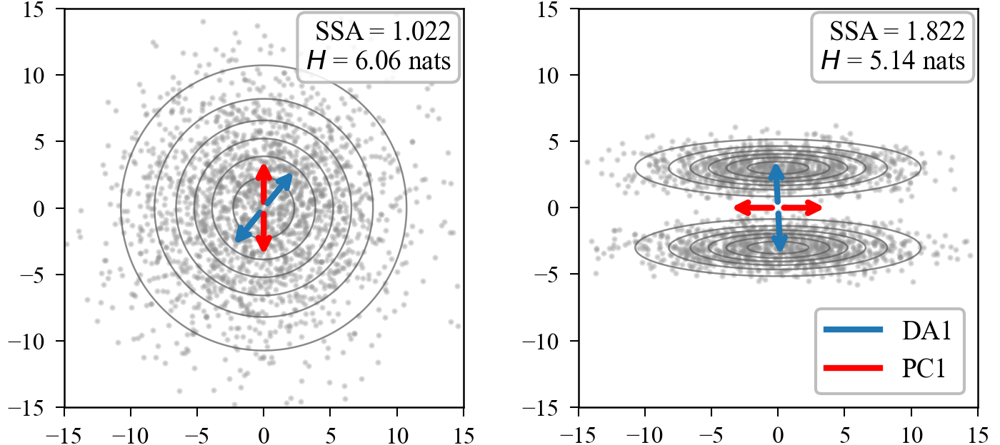
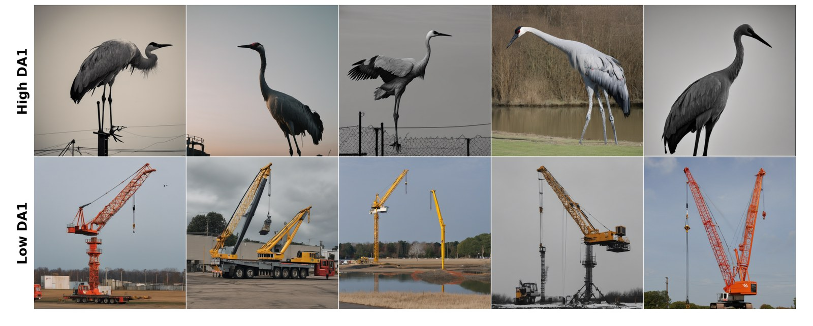
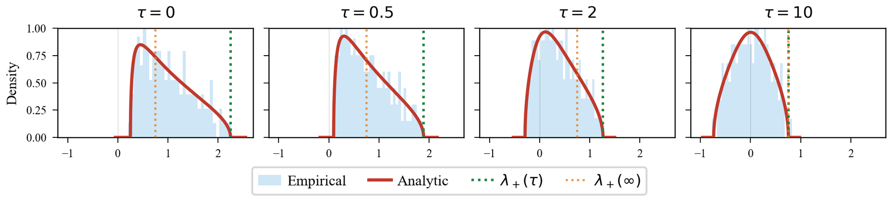
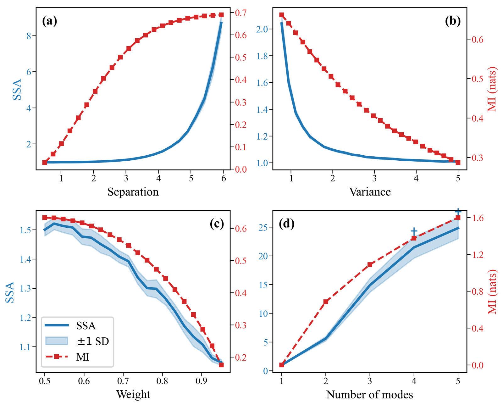
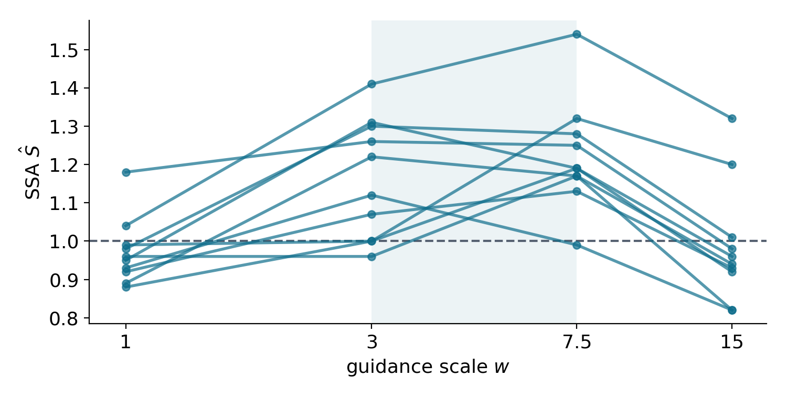
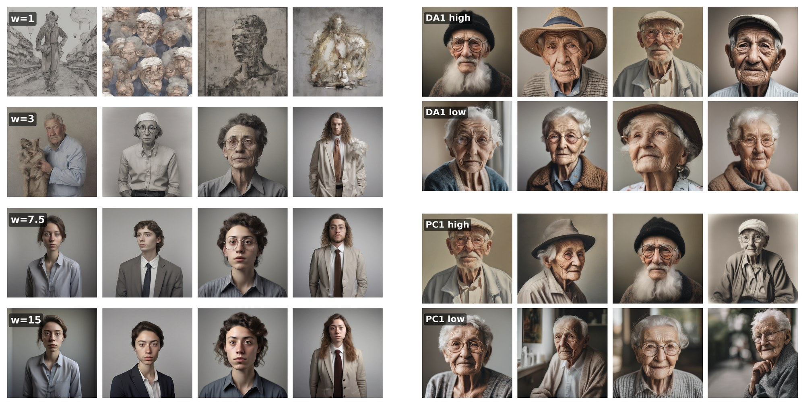
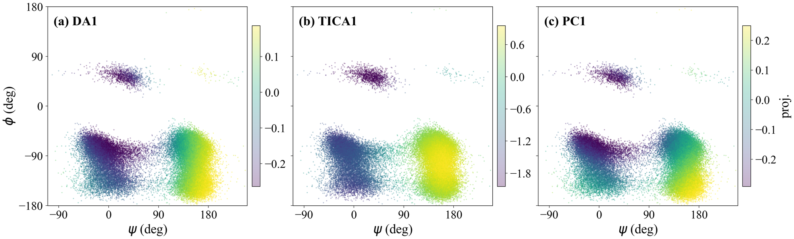

<h1 align="center">Measuring and Decomposing Mode Separation<br>via the Canonical Diffusion</h1>

<p align="center">
  <b>Shaul Tolkowsky</b> · <b>Ori Meidler</b> · <b>Or Zuk</b><br>
  Hebrew University of Jerusalem · NeurIPS 2026
</p>

<p align="center">
  <a href="https://arxiv.org/abs/2605.08777"></a>
  
  
  
</p>

<p align="center">
  <a href="https://arxiv.org/abs/2605.08777">Paper</a> ·
  <a href="#use-it-on-your-own-data">Use it on your data</a> ·
  <a href="#citation">Citation</a> ·
  <a href="#reproducing-the-paper">Reproduce the experiments</a>
</p>

<p align="center">
  
</p>

> **From samples and a score alone, SSA measures how strongly a distribution splits
> into modes, and DA finds the directions that split it.**

How sharply a density fragments into barrier-separated modes is a different property
from how widely it spreads, and the standard label-free tools only see spread: entropy
grows with dispersion, and PCA ranks directions by variance. We attach to every density
a unique reversible diffusion, the *canonical diffusion*, and read two quantities off
its autocovariance: **SSA**, a single number that grows with barrier height, and **DA**,
linear directions ordered by metastability rather than variance. Both need only samples
and a score function, so they run on pretrained diffusion models through Tweedie's
identity. We test them on Gaussian mixtures, SDXL generations and molecular dynamics of
alanine dipeptide.

<details>
<summary><b>Full abstract</b></summary>
<br>

Mode separation, namely how sharply a distribution fragments into barrier-separated
clusters, is a fundamental geometric property of densities, difficult to quantify in
high dimensions. Modes are often the meaningful alternatives in the data, such as the
conformations of a molecule or the distinct semantic types among a generative model's
outputs. Mode separation is distinct from dispersion, which is what standard label-free
tools capture: differential entropy rises with spread regardless of fragmentation, and
PCA orders directions by variance regardless of barriers. Mutual information does
capture it, but only given the latent component labels, which are usually unavailable.
We measure mode separation through a single stochastic process intrinsic to the density,
namely the unique reversible diffusion with $f$ as its stationary distribution and a
constant scalar diffusion coefficient. From its autocovariance matrix we extract two
readouts. The first, SSA (Sum of Squared Autocorrelations), is a scalar barrier-sensitive
measure. The second, DA (Dominant Autocorrelation directions), gives linear projections
ordered by metastability rather than variance. Under an isotropic-Gaussian null, we
derive the limiting spectrum of the empirical autocovariance in closed form, generalizing
the Marchenko–Pastur law. Its upper edge gives a noise floor that separates metastable
directions from sampling noise. Both readouts use only samples and a score function,
scaling to high dimensions through pretrained score-based generative models via
Tweedie's identity. We apply our framework to three settings: (i) synthetic Gaussian
mixtures, where SSA tracks mutual information; (ii) SDXL text-to-image generations,
where SSA and DA capture structure that entropy and PCA miss; and (iii) molecular
dynamics of alanine dipeptide, where DA recovers the known slow backbone dihedrals from
static samples alone.

</details>

## Separation, not spread

<p align="center">
  
</p>

An isotropic Gaussian (left) and two parallel elongated modes (right). **Entropy** ranks
the blob higher ($H$ = 6.06 vs. 5.14 nats), because it is more spread out. **SSA** ranks
the two modes higher (1.82 vs. 1.02), because a diffusion has to cross a barrier to move
between them. On the right, **DA1** (blue) points across the barrier, while **PC1** (red)
follows the larger within-mode variance. Projected onto DA1, the data are clearly bimodal
(dip test $p < 10^{-3}$); projected onto PC1, they are not ($p = 0.99$). On the blob,
neither method has a preferred direction, so both arrows are noise.

## One prompt, two cranes

<p align="center">
  
</p>

The same effect in a real generative model. SDXL's outputs for *"a photo of a crane"*
($w = 7.5$) have the highest SSA of all prompts we tested ($\hat S = 1.54$), because the
model produces both senses of the word. Sorting the samples along DA1 puts every bird at
one end and every construction crane at the other.

## The problem

- **Question:** how sharply does a distribution split into **modes**, clusters separated
  by low-density barriers?
- **Why it matters:** modes are the meaningful alternatives in data, such as a
  molecule's conformations or the distinct types among a generative model's outputs.
- **Why it is hard:** separation is difficult to measure in high dimensions, and mode
  labels are usually unavailable.
- **The gap:** existing label-free tools see spread, not separation.

| Tool | Needs mode labels? | What it measures |
|---|:---:|---|
| Differential entropy | no | spread |
| PCA | no | directions of largest variance |
| Mutual information $I(X;Z)$ | **yes** | separation |
| Hartigan's dip test | no | separation, in 1D only |
| **SSA / DA (this work)** | **no** | **separation, in any dimension, from samples + a score** |

## The method

**The canonical diffusion.** For a density $f$, take the reversible diffusion with
stationary density $f$ and constant scalar noise $\sigma_f^2 = \mathrm{tr}\,\mathrm{Cov}_f(X)/d$.
It is unique, and it only needs the score $\nabla \log f$:

```math
dX_t \;=\; \tfrac12\,\sigma_f^2\,\nabla\log f(X_t)\,dt \;+\; \sigma_f\,dW_t
```

**Its autocovariance.** $C(\tau)$ measures how much the centered process
$Y_t = X_t - \mathbb{E}_f[X]$ still remembers where it was a time $\tau$ ago. Each slow
mode $k$ (direction $\alpha_k$) fades at rate $\mu_k$, and barriers make $\mu_k$ small:

```math
C(\tau) \;=\; \mathbb{E}_f\!\left[Y_\tau Y_0^{\top}\right] \;=\; \sum_{k\ge 2} e^{-\mu_k \tau}\,\alpha_k\alpha_k^{\top}
```

**SSA** integrates the squared trace-normalized autocorrelation
$\rho(\tau) = \mathrm{tr}\,C(\tau)/\mathrm{tr}\,C(0)$, where $w_k$ is the share of variance
carried by mode $k$. It equals 1 for a unimodal isotropic Gaussian and grows without
bound as barriers deepen:

```math
S(f) \;=\; \int_0^\infty \rho(\tau)^2\,d\tau \;=\; \sum_{k,\ell\ge 2} \frac{w_k\,w_\ell}{\mu_k+\mu_\ell}
```

**DA** is the eigendecomposition of $C(\tau)$ at a long lag. Fast modes have decayed by
then, so the leading eigenvector aligns with the slowest mode $\alpha_2$, with error
$O\big(e^{-2(\mu_3-\mu_2)\tau}\big)$, regardless of how much variance it carries.

**But we only see $\hat C(\tau)$.** With finitely many trajectories, part of the
spectrum of the estimated autocovariance is noise. For pure noise, an isotropic Gaussian
with $\gamma = d/N$, we derive its limit spectrum in closed form (a free additive
convolution of two Marchenko–Pastur laws). The upper edge $\lambda_+(\tau)$ is the noise
floor: directions above it are slow, directions below it are sampling noise.

<p align="center">
  
</p>

*Eigenvalues of $\hat C(\tau)$ under the isotropic Gaussian null at $\tau = 0, 0.5, 2, 10$
(histogram) against the analytic density (red). Green: the edge $\lambda_+(\tau)$; orange:
its $\tau\to\infty$ limit. At $\tau = 0$ this is the Marchenko–Pastur law, with
$\lambda_+(0) = \sigma^2(1+\sqrt\gamma)^2$.*

## Results

### SSA tracks mutual information, without the labels

<p align="center">
  
</p>

On 10-dimensional Gaussian mixtures, SSA (blue) and mutual information with the true
component labels (red) agree across sweeps in (a) mode separation, (b) within-mode
variance, (c) weight imbalance and (d) number of modes. Mutual information saturates at
$\log k$ while SSA keeps growing with barrier height. Over 50 random mixtures, their
Spearman rank correlation is 0.89.

### SSA peaks at intermediate guidance

<p align="center">
  
</p>

SSA of SDXL's outputs for 10 prompts at four classifier-free guidance scales $w$. Every
prompt peaks at $w = 3$ or $w = 7.5$ (shaded), never at the extremes. The dashed line is
the unimodal baseline $S = 1$. Low guidance gives diverse but weakly on-prompt images;
high guidance collapses onto a few repeated types; in between, the model produces several
distinct, coherent types.

### DA finds what PCA mixes

<p align="center">
  
</p>

**Left:** *"a professional photograph of a person"* at $w = 1, 3, 7.5, 15$.
**Right:** *"a portrait of an elderly person"* ($w = 7.5$), with the images at each end
of DA1 and of PC1. DA1 separates the samples by gender (Spearman $|\rho| = 0.90$); PC1
mixes gender with realism and style.

<p align="center">
  
</p>

**Alanine dipeptide**, featurized as 45 pairwise distances. TICA needs the MD trajectory;
DA uses only static samples and a KDE score. Both find the backbone dihedral $\psi$ as
the slowest coordinate: DA1 tracks $\psi$ ($|r| = 0.67$) and DA2 tracks $\phi$ (0.87),
the same order as TICA, while PC1 mixes the two (0.56 and 0.60).

## Main contributions

- **Canonical diffusion:** a unique reversible diffusion for any density, needing only
  its score and first two moments.
- **Scales to pretrained models:** any denoiser supplies the score via Tweedie's identity
  (SDXL latent space, $d = 65{,}536$).
- **SSA:** a label-free measure of mode separation that ranks mixtures like mutual
  information, without the labels.
- **DA:** linear directions ordered by metastability rather than variance.
- **Noise floor:** the limit spectrum of the lagged autocovariance in closed form,
  generalizing Marchenko–Pastur.

## Use it on your own data

> A pip-installable package with a direct `ssa(...)` / `da(...)` interface is planned.
> Until then, the pipeline lives in [`src/pipeline/`](src/pipeline).

```bash
git clone https://github.com/shaulTol/ABM.git && cd ABM
pip install -r requirements.txt
```

You need samples from $f$ and its score $\nabla\log f$: analytic, a KDE
([`src/kde/kde_score.py`](src/kde/kde_score.py)), or a pretrained diffusion model
through Tweedie's identity. A two-mode toy example:

```python
import numpy as np
import torch
from src.pipeline import save_lags, compute_ssa, compute_da, n_metastable

# Toy target: two Gaussian modes at (±2, 0) with variance 0.5
mus, var = torch.tensor([[2.0, 0.0], [-2.0, 0.0]], dtype=torch.float64), 0.5

def score(x):                       # ∇ log f(x), x: (N, d) tensor
    diff = x[:, None, :] - mus[None]                    # (N, k, d)
    w = torch.softmax(-(diff ** 2).sum(-1) / (2 * var), dim=1)
    return -(w[..., None] * diff).sum(1) / var

rng = np.random.default_rng(0)
X0 = rng.normal(scale=var ** 0.5, size=(500, 2))     # samples from f
X0[:, 0] += rng.choice([-2.0, 2.0], size=500)
sigma_f_sq = np.trace(np.cov(X0.T)) / X0.shape[1]    # σ_f² = tr Cov / d

# 1. Simulate the canonical diffusion and save C(τ) on a lag grid (lag 0 first)
save_lags(score, X0, sigma_f_sq, dt=0.01, T_steps=10_000,
          lags=range(0, 10_001, 20), out_path='toy.npz', save_trajectories=True)

# 2. SSA (≈ 6 here; a single Gaussian gives ≈ 1)
print('SSA =', compute_ssa('toy.npz')['s_hat'])

# 3. DA: number of metastable directions, then the directions themselves
m = n_metastable('toy.npz')
if m['m_hat']:
    da = compute_da('toy.npz', tau_idx=m['tau_star_idx'], m=m['m_hat'])
    print('DA1 =', da['eigenvectors'][:, 0])          # ≈ ±(1, 0): across the barrier
```

The same steps from the shell, once the NPZ exists:

```bash
python -m cli.compute_ssa toy.npz --bootstrap 2000   # SSA with a trajectory-bootstrap SE
python -m cli.compute_da toy.npz --significance 100  # DA with the matched Monte Carlo null
```

## Citation

```bibtex
@inproceedings{tolkowsky2026modeseparation,
  title     = {Measuring and Decomposing Mode Separation via the Canonical Diffusion},
  author    = {Tolkowsky, Shaul and Meidler, Ori and Zuk, Or},
  booktitle = {Advances in Neural Information Processing Systems},
  year      = {2026},
  eprint    = {2605.08777},
  archivePrefix = {arXiv}
}
```

---

## Reproducing the paper

Everything below is the repository guide: how the code maps to the paper, how to set up
the environment and cluster, and how to rerun each experiment and regenerate each figure.

### Algorithm Overview

Given samples from an unknown density f, the method works in three stages:

**Stage 1 — Canonical diffusion** (Algorithm 1, `src/pipeline/save_lags.py`).
Run the isotropic Langevin SDE:  *dX = (σ²_f / 2) ∇log f(X) dt + σ_f dW*,
where σ²_f = tr(Cov(X)) / d. Collect N trajectories, each of length T.
Compute the symmetrized autocovariance C_sym(τ) = (C(τ) + C(τ)ᵀ) / 2
at a grid of lags.

**Stage 2a — SSA** (`src/pipeline/compute_ssa.py`).
At each lag compute the trace-normalized autocorrelation
ρ̂(τ) = tr Ĉ(τ) / tr Ĉ(0), with Ĉ(τ) the trajectory-averaged lag-τ
autocovariance centered at the pooled sample mean.
Truncate at the first lag where ρ̂(τ)² ≤ 1/N (that lag included). Sum:
**Ŝ = Δt · Σ ρ̂(ℓΔt)²**.
A unimodal isotropic Gaussian gives Ŝ ≈ 1; Ŝ grows with barrier height.
Standard errors come from a trajectory bootstrap.

**Stage 2b — DA directions** (`src/pipeline/compute_da.py`).
τ\*(m) is the largest lag at which (i) the top m eigenvalues of C_sym(τ) exceed
the null threshold (the analytic free-convolution edge λ₊(τ), or the matched
Gaussian Monte Carlo null with Bonferroni over the m directions), (ii) the 1D
projection onto each of v₁…v_m rejects unimodality (dip test), and
(iii) ρ̂(τ) < 1/e. The number of metastable directions is the largest m with a
τ\*(m). The eigenvectors of C_sym(τ\*) are the DA directions, ordered by
metastability.

#### Code ↔ Paper Mapping

| Paper | Code | Description |
|-------|------|-------------|
| Algorithm 1 (`alg:ssa_da`) | `src/pipeline/save_lags.py` | Langevin simulation + C_sym(τ) computation |
| SSA estimator + 1/N stopping rule (`eq:ssa_estimator`, `eq:tmax_stopping`) | `src/pipeline/compute_ssa.py` | Riemann sum truncated at the first 1/N crossing; trajectory bootstrap |
| DA lag-selection criterion (Section "DA") | `src/pipeline/compute_da.py` | τ\*(m), m̂, eigenvectors of C_sym(τ\*) |
| Algorithm 2 (`alg:operational_floor`) | `src/pipeline/compute_da.py` (`da_significance`) | Matched-Gaussian Monte Carlo null |
| Theorem 2 (`thm:limit-spectrum`) | `src/noise_floor/free_conv_utils.py` | Free-convolution upper edge λ₊(τ) |
| Langevin integrator | `src/simulation/langevin.py` | Euler-Maruyama SDE solver |
| KDE score estimator | `src/kde/kde_score.py` | ∇log f̂ for tabular data |
| DDPM score (SDXL) | `experiments/sdxl/sdxl_components.py` | Tweedie denoiser as score oracle |

### Setup

```bash
pip install -r requirements.txt
# For SDXL experiments: GPU required (L40S 48GB recommended)
# Additional: pip install latent_clip open_clip_torch==3.3.0 diffusers==0.30.0
```

#### Cluster Configuration

SLURM scripts use placeholders. Replace them before running:

| Placeholder | Meaning | Example |
|-------------|---------|---------|
| `<CLUSTER_USER>` | Your cluster username | `jdoe` |
| `<CLUSTER_HOST>` | SSH jump host for tunnel | `gateway.university.edu` |
| `<PROJECT_DIR>` | Absolute path to this repo on cluster | `/scratch/jdoe/ssa-paper` |
| `<CONDA_ENV>` | Absolute path to conda environment | `/scratch/jdoe/envs/ssa_env` |
| `<CONDA_SH>` | Path to `conda.sh` activation script | `/opt/miniconda3/etc/profile.d/conda.sh` |
| `<CONDA_BIN>` | Path to conda `bin/` directory | `/opt/miniconda3/bin` |
| `<NV_SITE_PACKAGES>` | nvidia packages in site-packages | `<CONDA_ENV>/lib/python3.12/site-packages/nvidia` |
| `<USER_SITE_PACKAGES>` | User-installed nvidia packages | `~/.local/lib/python3.12/site-packages/nvidia` |
| `<TORCH_LIB>` | PyTorch shared libraries | `<CONDA_ENV>/lib/python3.12/site-packages/torch/lib` |
| `<HF_CACHE>` | Hugging Face model cache | `~/.cache/huggingface` |

### Repository Structure

```
src/                    Core library
  core/                 Gaussian-mixture definitions, device/GPU helpers
  metrics/              SSA, DA, autocorrelation
  simulation/           Langevin integrator
  kde/                  KDE score estimator
  noise_floor/          Free-convolution density and noise floor
  pipeline/             Algorithm 1 end to end: save_lags → compute_ssa / compute_da
  plotting/             Shared figure styling
cli/                    Command-line wrappers around src/pipeline
experiments/
  synthetic/            synthetic validation: GMM sweeps, planted spikes, ellipses, noise floor
  sdxl/                 SDXL: SDXL guidance sweep, elderly DA, crane
  alanine/              molecular: alanine dipeptide KDE-DA, baselines, MC null
  robustness/           Appendix "Additional Robustness and Scope Controls"
    score_error/        Sensitivity to score-estimation error
    numerics/           Numerical parameters (N, Δt, lag window; Gaussian vs ellipses)
    sdxl_lag/           SDXL horizon and lag dependence (elderly DA across lags)
    null_scope/         Scope of the analytic null (overlapping pairs, score error)
    geometry/           Anisotropy, degenerate slow subspaces, and feature visibility
    figures/            Output of the robustness figure scripts
```

---

### Running the Experiments

Each experiment follows the same pattern: a **producer** script runs the
Langevin simulation and saves results, then a **figure** script reads those
results and generates plots. Producer scripts are submitted as SLURM jobs;
figure scripts run locally in seconds.

#### Synthetic GMMs ("Validation on synthetic distributions")

**GMM parameter sweeps** (Fig 1a-d) — SSA vs separation, variance, weight, mode count:
```bash
# Run (GPU, ~12h):
sbatch experiments/synthetic/cluster/run_gmm_sweeps.sh
# Output: experiments/synthetic/results/gmm_10d_n200_all_sweeps_T200.json
```

**Random GMM scatter** (Fig A2) — SSA rank vs MI rank over 50 random GMMs:
```bash
sbatch experiments/synthetic/cluster/run_random_sweep.sh
# Output: experiments/synthetic/results/random_sweep_10d_n200.json
```

**dt-robustness** (Fig A3) — SSA stability across dt in {0.005, 0.01, 0.02}:
```bash
sbatch experiments/synthetic/cluster/run_dt_robustness.sh
# Output: experiments/synthetic/results/gmm_10d_n200_dt_robustness.json
```

**On-the-fly experiments** (no pre-computation needed):
```bash
cd experiments/synthetic
python fig_dispersion.py           # Fig 1e: dispersion vs fragmentation
python fig_parallel_ellipses.py    # Fig 1f + A9: DA1 recovers slow axis
python fig_a0_identity.py          # A0=sigma^2 I scale invariance
python fig_noise_floor.py          # Fig A10-A13: free-conv validation
```

**Planted spikes** (Fig A15):
```bash
cd experiments/synthetic
python simulate_planted_spikes.py  # produces results/fig_planted_spikes.npz
```

**Ellipses MC null** (Table 4):
```bash
sbatch experiments/synthetic/cluster/run_ellipses_null.sh
# Output: experiments/synthetic/results/ellipses_null_results.npz
```

#### SDXL Guidance Sweep ("SSA and DA on SDXL generations in CLIP space")

**SSA across 14 prompts x 4 guidance scales** (Fig 3, Table 1):
```bash
# Step 1: Generate x0 latents + compute entropy (GPU, array 0-27, ~7h each):
sbatch experiments/sdxl/cluster/run_guidance_gen.sh

# Step 2: Run Langevin + compute SSA (GPU, array 0-27, ~19h each):
sbatch experiments/sdxl/cluster/run_guidance_ssa.sh

# Step 3: Trajectory-averaged SSA recompute (GPU, array 0-23):
sbatch experiments/sdxl/cluster/run_traj_averaged.sh

# Step 4: Bootstrap SEs (CPU, single job, ~10 min; pooled estimator, 1/N rule):
sbatch experiments/sdxl/cluster/run_bootstrap_ssa.sh
# Output: experiments/sdxl/results/bootstrap_pooled/bootstrap_<cell>.json
```

**Elderly DA extraction** (Fig 4, A7, A8):
```bash
# DA directions (GPU, ~24h):
sbatch experiments/sdxl/cluster/run_da_elderly.sh

# C(tau) for spectrum figure (GPU, ~20h):
sbatch experiments/sdxl/cluster/run_sdxl_C_tau.sh

# C(0) eigenvalues for free-conv overlay:
sbatch experiments/sdxl/cluster/run_save_c0_eigvals_elderly.sh
```

**MC null test** (Table 4 SDXL row):
```bash
sbatch experiments/sdxl/cluster/run_sdxl_null.sh  # array 0-2, ~19h each
```

**Image decode** (crane extremes, guidance grids):
```bash
sbatch experiments/sdxl/cluster/run_decode_crane.sh
sbatch experiments/sdxl/cluster/run_decode_grids.sh
```

#### Alanine Dipeptide ("Molecular conformational landscapes")

Requires raw MD trajectories in `experiments/alanine/alanine_dipeptide/data/`
(~135 MB, download from [MDshare](http://ftp.imp.fu-berlin.de/pub/cmb-data/)).

**C(tau) + KDE-DA** (Fig 5, Table 2):
```bash
# C(tau) at 38 lags (GPU, ~4h):
sbatch experiments/alanine/cluster/run_alanine_C_tau.sh

# KDE-DA directions (GPU, ~12h):
sbatch experiments/alanine/cluster/run_alanine_kde_da.sh
```

**MC null test** (Table 4 alanine row):
```bash
sbatch experiments/alanine/cluster/run_alanine_null.sh  # array 0-9, ~8 min each
```

**Baselines** (Table 3 — sparse K-means, spectral map, diffusion maps):
```bash
sbatch experiments/alanine/cluster/run_baselines.sh  # CPU-only, ~10 min each
```

**On-the-fly** (no pre-computation):
```bash
cd experiments/alanine
python fig_tica_its.py  # Fig A14: TICA implied timescales
```

#### Robustness and Scope Controls (Appendix "Additional Robustness and Scope Controls")

Code in `experiments/robustness/`, one folder per subsection. SSA values use the
paper's 1/N first-crossing stopping rule; result files tagged `_fc` (first
crossing) are the ones the appendix reports. Small JSON/MD/CSV results are
tracked; `.npz` arrays are not.

**Sensitivity to score-estimation error** (`fig:rebuttal_score_error`):
```bash
sbatch experiments/robustness/score_error/cluster/run_score_robustness.sh        # GPU array 0-49
sbatch experiments/robustness/score_error/cluster/run_score_robustness_merge.sh  # CPU, after the array
cd experiments/robustness/score_error
python analyze_absolute_sensitivity.py   # median / p90 |ΔŜ| -> results/p9_absolute_sensitivity_fc*
python fig_score_error.py
```

**Numerical parameters** (`fig:rebuttal_numerics`):
```bash
sbatch experiments/robustness/numerics/cluster/run_numerical_robustness.sh   # N and Δt ladder
sbatch experiments/robustness/numerics/cluster/run_dispersion_robustness.sh  # Gaussian vs ellipses grid
cd experiments/robustness/numerics && python fig_numerical_robustness.py
```

**SDXL horizon and lag dependence** (elderly DA across lags; CPU, reads the
elderly DA results in `experiments/sdxl/results/`):
```bash
cd experiments/robustness/sdxl_lag
python reconcile_mc_null.py && python compute_lag_sensitivity.py   # -> RESULTS.md, results.json
```

**Scope of the analytic null** (`fig:rebuttal_null_score_error`):
```bash
sbatch experiments/robustness/null_scope/cluster/run_score_error_null.sh   # CPU
cd experiments/robustness/null_scope && python fig_null_fpr.py
```

**Anisotropy, degenerate slow subspaces, and feature visibility**
(`fig:rebuttal_geometry_gmm`, `fig:rebuttal_geometry_rings`):
```bash
sbatch experiments/robustness/geometry/cluster/run_four_mode_and_flat_top.sh   # CPU
cd experiments/robustness/geometry
python p3b_polar_da.py --ratio 8 --T 12000 --lags 250,1000,2000,3000           # two-shell rings, CPU
python fig_da_subspace.py && python fig_rings.py
```

---

### Reproducing Figures from Pre-computed Results

All small result files (JSON/CSV, ~1.5 MB total) are tracked in git.
Binary NPZ files are gitignored — sync from cluster or regenerate via SLURM.

Once results are in place, figures regenerate locally in seconds (CPU-only):

#### Main Text

| Figure | Command |
|--------|---------|
| Fig 1a-d (GMM sweeps) | `cd experiments/synthetic && python fig_gmm_sweeps.py` |
| Fig 1e (dispersion) | `cd experiments/synthetic && python fig_dispersion.py` |
| Fig 1f (parallel ellipses) | `cd experiments/synthetic && python fig_parallel_ellipses.py` |
| SDXL figure (`fig:sdxl_combined`) | `cd experiments/sdxl && python fig_sdxl_grids.py` |
| Fig 4 (elderly DA grid) | `cd experiments/sdxl && python fig_elderly_da.py --mode grid` |
| Fig 5 (alanine DA vs TICA) | `cd experiments/alanine && python fig_alanine_da_tica.py` |

#### Appendix

| Figure | Command |
|--------|---------|
| Fig A1 (GMM snapshots) | same as Fig 1 |
| Fig A2 (random sweep) | `cd experiments/synthetic && python fig_random_sweep.py` |
| Fig A3 (dt-robustness) | `cd experiments/synthetic && python fig_dt_robustness.py` |
| Fig A4-A5 (alanine bulk) | `cd experiments/alanine && python fig_alanine_bulk.py` |
| Fig A6 (spike count vs tau) | `cd experiments/alanine && python fig_alanine_spike_count.py` |
| Fig A7 (elderly spectrum) | `cd experiments/sdxl && python fig_elderly_da.py --mode spectrum` |
| Fig A8 (elderly histograms) | `cd experiments/sdxl && python fig_elderly_da.py --mode histogram` |
| Fig A9 (ellipses convergence) | same as Fig 2b |
| Fig A10-A13 (noise floor) | `cd experiments/synthetic && python fig_noise_floor.py` |
| Fig A14 (TICA timescales) | `cd experiments/alanine && python fig_tica_its.py` |
| Fig A15 (planted spikes) | `cd experiments/synthetic && python fig_planted_spikes.py --npz results/fig_planted_spikes.npz` |
| $A_0 = \sigma^2 I$ figure | `cd experiments/synthetic && python fig_a0_identity.py` |

#### Robustness appendix

| Figure | Command |
|--------|---------|
| `fig:rebuttal_score_error` | `cd experiments/robustness/score_error && python fig_score_error.py` |
| `fig:rebuttal_numerics` | `cd experiments/robustness/numerics && python fig_numerical_robustness.py` |
| `fig:rebuttal_null_score_error` | `cd experiments/robustness/null_scope && python fig_null_fpr.py` |
| `fig:rebuttal_geometry_gmm` | `cd experiments/robustness/geometry && python fig_da_subspace.py` |
| `fig:rebuttal_geometry_rings` | `cd experiments/robustness/geometry && python fig_rings.py` |

Outputs go to `experiments/robustness/figures/`.

#### Tables

| Table | Command |
|-------|---------|
| Table 1 + SE and full tables (SDXL SSA) | `cd experiments/sdxl && python table_sdxl_ssa.py` |
| Table 2 (alanine lag sensitivity) | `cd experiments/alanine && python table_alanine_lag_sensitivity.py` |
| Table 3 (alanine baselines) | `cd experiments/alanine && python table_alanine_baselines.py` |
| Table 4 (Bonferroni significance) | `cd experiments/alanine && python table_alanine_bonferroni.py` |

---

### Syncing Results from Cluster

For binary NPZ files:

```bash
# Set up SSH tunnel (replace with your cluster details)
ssh -N -L 2222:<CLUSTER_HOST>:22

# Sync all result files (replace <CLUSTER_USER> and <PROJECT_DIR>)
rsync -avz -e 'ssh -p 2222' \
  <CLUSTER_USER>@localhost:<PROJECT_DIR>/experiments/synthetic/results/ \
  experiments/synthetic/results/

rsync -avz -e 'ssh -p 2222' \
  <CLUSTER_USER>@localhost:<PROJECT_DIR>/experiments/sdxl/results/ \
  experiments/sdxl/results/

rsync -avz -e 'ssh -p 2222' \
  <CLUSTER_USER>@localhost:<PROJECT_DIR>/experiments/alanine/results/ \
  experiments/alanine/results/
```

---

### Compute Requirements

All experiments run on single-GPU SLURM jobs. No multi-GPU or distributed
training is required.

| Experiment | GPU | Array jobs | Est. GPU-hrs |
|---|---|---|---|
| SDXL guidance sweep SSA (Fig 3) | L40S | 28 | 532 |
| SDXL generation + entropy (Fig 3) | L40S | 28 | 196 |
| SDXL traj-averaged recompute (Table 1) | L40S | 24 | 192 |
| SDXL MC null (Table 4) | L40S | 3 | 57 |
| SDXL bootstrap SEs (Table 1) | CPU | 1 | <1 |
| SDXL elderly DA (Fig 4) | L40S | 1 | 24 |
| SDXL C(tau) (Fig A7) | L40S | 1 | 20 |
| SDXL decode grids + crane | L40S | 29 | 15 |
| GMM sweeps + random + dt-robust (Fig 1, A2, A3) | L4 | 3 | 24 |
| Alanine KDE-DA (Fig 5) | L40S | 1 | 6 |
| Alanine C(tau) + null + baselines | L4 | 12 | 5 |
| On-the-fly figures (Fig 1e-f, A0, A9-A14) | CPU | -- | <1 |
| **Total** | | | **~1,100** |

SDXL Langevin dominates (~950 GPU-hours): each cell runs N=200 trajectories x
T=2000 UNet forward passes at 1024x1024, taking ~19h on L40S.

**Faster autocorrelation (added after publication).**
`compute_vector_autocorrelation` (and `compute_vector_ssa_score`) in
`src/metrics/autocorrelation.py` accept `method='fft'`, which computes all lags
at once via Wiener–Khinchin in O(N·d·T log T) instead of the per-lag loop. It
computes the same estimator and matches the default `method='loop'` up to
float32 rounding (|Δρ| ≈ 1e-6). All results in the paper use the default loop.

**Minimal reproduction:** To regenerate figures from pre-computed results
(tracked JSON/CSV + synced NPZ): CPU-only, completes in minutes.
